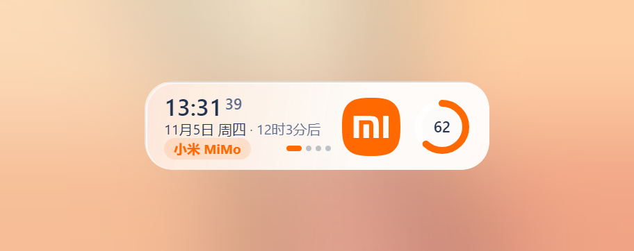
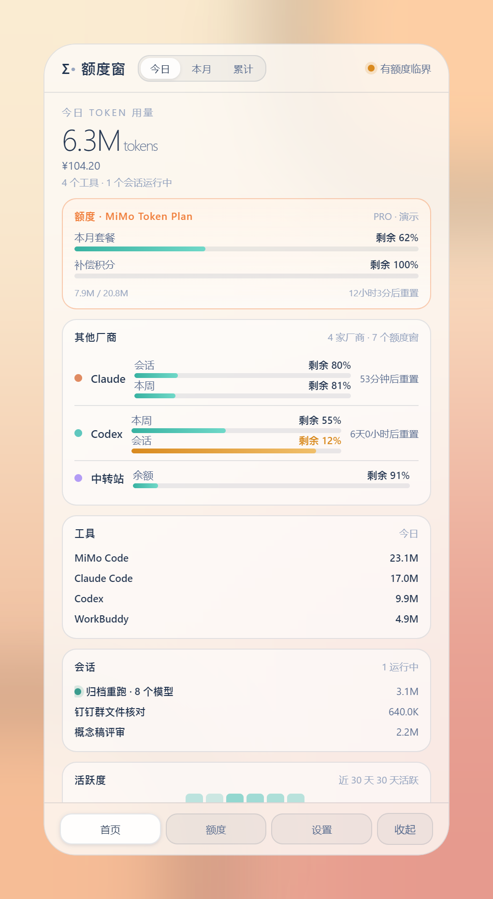
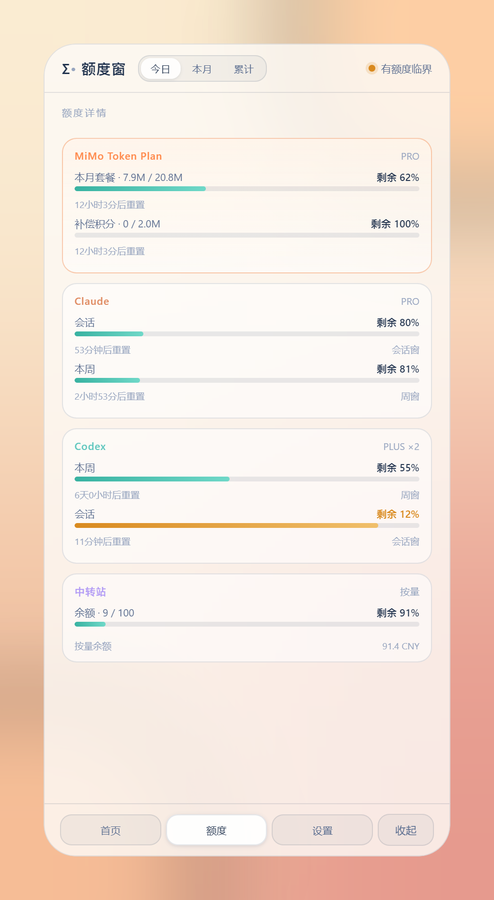

<div align="center">
    
    <h1>额度窗 · TokenQuota Widget</h1>
    <p><em>一块玻璃看尽 AI Token 额度 —— Windows 桌面仪表盘，MiMo Token Plan 置顶。</em></p>
    <p>
        
        
        
        
    </p>
</div>

## 它是什么

一个 **本地优先** 的 Windows 桌面小部件：把各家 AI 编码工具的 Token 额度、用量与成本聚进一块无边框透明玻璃里。白天暖玻璃、夜里可切夜间玻璃；大窗看全貌，拖到屏幕顶端自动收成 **248×64 的吸顶小窗**——时间日期、厂名徽标、品牌 logo 与迷你环形图一屏排开，轮转到哪家就亮哪家。

开箱即用：不配置任何账号时以演示数据展示；配上 MiMo 后立刻换成真实额度。

<div align="center">
    <table>
        <tr>
            <td width="435" align="center"><br><sub><b>主窗 420×840</b> — 总量 / MiMo 置顶卡 / 多厂商额度 / 会话 / 活跃度热力图 / AI 热榜</sub></td>
            <td width="435" align="center"><br><sub><b>吸顶小窗 248×64</b> — 时间 / 日期 / 厂名徽标、厂商 logo 入列、环形图直读剩余，多厂商每 5 秒轮转</sub></td>
        </tr>
        <tr>
            <td colspan="2" align="center"><br><sub><b>额度详情</b> — 每家厂商的全部额度窗、重置倒计时、按量余额</sub></td>
        </tr>
    </table>
</div>

## 特性

### 额度

- **MiMo Token Plan 双通道**：官方 `tp-` API Key（稳定不掉线）与控制台 Cookie（明细 + 按量余额）互补，谁在用谁生效
- **多额度窗**：套餐积分、补偿积分、会话窗、周窗各自一条剩余百分比 + 重置倒计时
- **多厂商聚合**：MiMo / Claude / Codex / WorkBuddy / 自定义端点（New API、One API 兼容网关）同屏并列
- **临界提醒**：剩余 <25% 转琥珀、<10% 转朱红；某家登录态失效只雾化那一张卡，其余照常
- **本地用量统计**：零凭据直扫 Claude Code / Codex / WorkBuddy 的本地会话日志，出今日 / 本月 / 累计 token、估算成本、30 天热力图与最近会话

### 形态

- **无边框透明玻璃**：Win11 DWM 边框全关，白天暖玻璃 / 夜间深玻璃一键切换
- **大窗 420×840 ↔ 吸顶小窗 248×64**：拖到屏幕顶边自动收起（与 [云上晴雨天气台](https://github.com/kmnn111/sky-weather-widget)、云上会议同规格），悬停展开，240ms clip-path 形变，窗口尺寸全程不变只做裁剪
- **Win+D 打不走**：置顶开 = screen-saver 级 topmost；置顶关 = 钉在壁纸层 WorkerW 正上方（`npm run selftest` 可实测）
- **小窗轮转**：配置 ≥2 家额度时每 5 秒横向滑入下一家（置顶厂商固定第一帧，其余按紧迫度排序）；只有 1 家完全静止
- **厂商 logo 入列**：小窗排下 文字 | 品牌 logo | 环形图 三段；内置 20 家厂商官方图标（小米 MiMo、OpenAI、Anthropic、Gemini、DeepSeek、通义、智谱、Kimi、豆包、混元、文心、MiniMax 等），无官方图标的自动品牌色文字标兜底，玻璃随厂商品牌色渐变
- **迷你环形图**：小窗右侧 44px 环形图直读剩余比例（弧长 + 中心数字），不重复显示大数字；轮转时弧长与颜色平滑过渡
- **AI 热榜**：大窗底部本日 / 本周最热 AI GitHub 项目，点击默认浏览器打开仓库页（主进程域名白名单，只放行 github.com）

### 隐私

- **本地优先**：额度数据直接从各家接口拉到本机渲染，无中间服务器
- **凭据只存本机**：Cookie / API Key 写在 `%APPDATA%/额度窗/settings.json`，不进仓库、不进日志、回传渲染层时打码
- **日志只读数值**：本地统计只读 usage 字段，正文一行不碰、不上传

## 支持的数据源

| 数据源 | 凭据 | 额度 | 用量 | 说明 |
|--------|------|:---:|:---:|------|
| **MiMo Token Plan** | `tp-` API Key | ✅ | — | 官方接口 `token-plan-cn.xiaomimimo.com/v1/platform/token_plan`，推荐 |
| **MiMo 控制台** | 浏览器 Cookie | ✅ | — | `platform.xiaomimimo.com/api/v1`，能看 items 明细与按量余额，约 24h 失效 |
| **Claude Code** | 无 | — | ✅ | 本地 `~/.claude/projects/` 会话日志 |
| **Codex** | 无 | — | ✅ | 本地 `~/.codex/sessions/` 会话日志 |
| **WorkBuddy** | 无 | — | ✅ | 本地 `~/.workbuddy/projects/` 会话日志 |
| **自定义端点** | Token（可选） | ✅ | — | 任一 GET JSON 接口，点号路径映射 `used / limit / resetAt`，兼容 New API / One API 网关 |

## 安装

### 方式一：安装包（推荐）

从 [Releases](../../releases) 下载 `额度窗-Setup-x.x.x.exe`，双击安装，桌面出现「额度窗」快捷方式。

### 方式二：源码运行

```bash
git clone https://github.com/kmnn111/token-quota-widget.git
cd token-quota-widget
npm install
npm start
```

## 快速上手：接入 MiMo Token Plan

1. 启动额度窗，底栏切到 **设置**
2. **通道 A（推荐）**：在 [MiMo 开放平台](https://mimo.mi.com) 的 Token Plan 页拿到 `tp-` 开头的专用 API Key，粘进第一栏保存
3. **通道 B（可选）**：浏览器登录 `platform.xiaomimimo.com` → F12 → Network → 任一 `/api/v1` 请求 → 复制完整 Cookie 请求头（须含 `api-platform_serviceToken` 与 `userId`）粘进第二栏
4. 回到首页：置顶卡立刻变成真实额度；吸顶小窗第一帧固定显示 MiMo

> 计划 API Key 与推理网关都读不到用量接口，控制台网关只认 Cookie —— 所以两条通道互补：API Key 管长期稳定，Cookie 管明细和余额。Cookie 失效时 MiMo 卡自动雾化并提示，其余厂商不受影响。

## 设置项

| 键 | 默认 | 说明 |
|----|------|------|
| `theme` | `light` | `light` 白天玻璃 / `dark` 夜间玻璃 |
| `rotateSeconds` | `5` | 小窗轮转间隔（秒），仅 1 家时自动静止 |
| `refreshMinutes` | `5` | 额度刷新间隔 |
| `trendingRange` | `daily` | AI 热榜范围 `daily` / `weekly` |
| `alwaysOnTop` | `true` | 置顶；关掉后吸顶小窗改为钉壁纸层 |
| `edgeDock` | `true` | 拖到屏幕顶边自动收起 |
| `providers` | `[]` | 数据源配置（凭据存在本机 settings.json） |

## 开发

```bash
npm start            # 运行
npm run dev          # 运行 + DevTools
npm run shot         # 自动截图自检（shot-out/ 出三张图）
npm run selftest     # Win+D / 显示桌面保活自检（真实调用 ToggleDesktop）
npm run dist         # 打 NSIS 安装包（dist/额度窗-Setup-x.x.x.exe）
```

### 目录结构

```
token-quota-widget/
├── main.js              # 主进程：窗口壳 / 吸顶形变 / Win+D 保活 / 托盘 / IPC
├── preload.js           # contextIsolation 桥
├── ext-guard.js         # 外链域名白名单
├── lib/
│   ├── http.js          # 零依赖 HTTPS
│   └── store.js         # 设置持久化（凭据打码回传）
├── providers/
│   ├── index.js         # 数据中枢：轮询 / 归一化 / 演示数据
│   ├── mimo.js          # MiMo 双通道
│   ├── local-logs.js    # 本地日志用量统计
│   ├── custom.js        # 自定义端点
│   └── github-trending.js # AI 热榜（Trending 页 + Search API 兜底）
├── renderer/            # 全中文界面（index.html / styles.css / app.js）
└── docs/                # 设计与接入文档
```

## 常见问题

**Q：按 Win+D 或点「显示桌面」，小窗会消失吗？**
不会。置顶开着时小窗是 screen-saver 级 topmost，天然免疫；置顶关着时进程每 100ms 把小窗钉在壁纸层 WorkerW 正上方——壁纸跃升时小窗跟着浮上来，全程不压任何程序。`npm run selftest` 两种模式都有实测输出。

**Q：MiMo Cookie 多久失效？**
约 24 小时。失效只会雾化 MiMo 卡并在设置里提示，重新粘贴一次即可；期间 API Key 通道不受影响。

**Q：界面数字和账单对不上？**
本地用量统计的 token 数是日志实测，成本是粗口径估算（不当账本）；额度百分比以官方接口为准。

**Q：支持 macOS / Linux 吗？**
窗口壳（WorkerW 胶水、NSIS、托盘行为）目前按 Windows 调校，其他平台未测试。

## 致谢

- [Javis603/token-monitor](https://github.com/Javis603/token-monitor) — 信息架构与数据密度参考（Σ• 顶栏、多额度窗、热力图、热榜）
- [steipete/CodexBar](https://github.com/steipete/CodexBar) 与 [Finesssee/Win-CodexBar](https://github.com/Finesssee/Win-CodexBar) — MiMo provider 接入思路
- [ryoppippi/ccusage](https://github.com/ryoppippi/ccusage) — 本地 JSONL 用量统计口径
- [kmnn111/sky-weather-widget](https://github.com/kmnn111/sky-weather-widget)（云上晴雨天气台）与云上会议 — 窗口壳、吸顶形变、Win+D 保活三保险的同款实现

## 许可证

[MIT](./LICENSE) · Copyright © 2026 kmnn111
